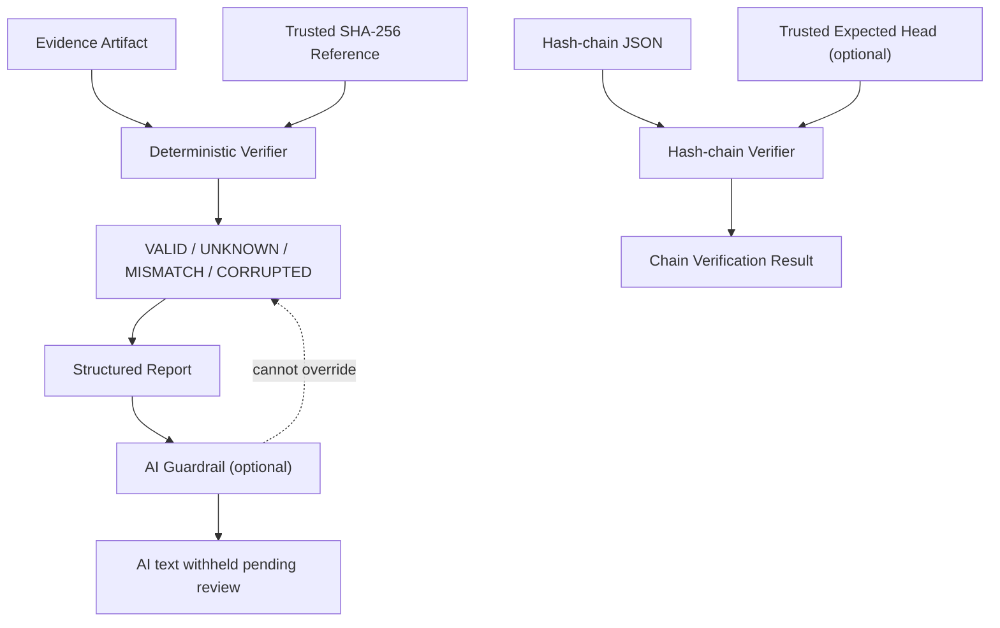

# G23 Evidence Copilot

**G23 Evidence Copilot by WaravutVisual** is a software evidence verification and claim-control prototype.

It uses deterministic checks to evaluate evidence artifacts, including SHA-256 integrity references and hash-chain verification. Its verification states are `VALID`, `UNKNOWN`, `MISMATCH`, and `CORRUPTED`.

Optional AI-generated explanations are non-authoritative and cannot override deterministic verification results. `VALID` means only that the defined checks passed; it does not establish runtime correctness or production readiness.

**Project scope:** general-purpose software verification and evidence integrity. This is not a medical AI copilot or a clinical decision-support system.

## Verification states

- VALID: evidence passed the defined deterministic checks
- UNKNOWN: required evidence is missing
- MISMATCH: evidence does not match the trusted reference
- CORRUPTED: evidence cannot be read or fails integrity validation

VALID does not imply runtime correctness or production readiness.
AI explanations must not override deterministic verification results.

## Architecture



**Trust boundary:** Deterministic verification owns the result state. AI text is non-authoritative and must not upgrade a verification result.

## Quick Demo

Run from the repository root. These checks do not require a Meta API key.

### 1. Verify the example hash chain

```bash
python -m app.hash_chain examples/hash-chain-demo.json
```

Show the actual state and explanation returned by the verifier.

### 2. Demonstrate the AI guardrail

```bash
python - <<'PY'
from app.ai_guardrail import build_guarded_result
from app.verifier import Result, State

verified = Result(
    State.VALID,
    "Artifact bytes match the supplied SHA-256 reference.",
    "0" * 64,
)

result = build_guarded_result(
    verified,
    lambda context: "The evidence proves production readiness.",
)

print("VERIFIER_STATE =", result["verification"]["state"])
print("AI_STATUS =", result["ai_explanation"]["status"])
print("AI_TEXT =", result["ai_explanation"]["text"])
print("AI_AUTHORITATIVE =", result["ai_explanation"]["is_authoritative"])
PY
```

Expected behavior: verifier state remains `VALID`; the raw AI sentence is withheld with `REVIEW_REQUIRED`; AI is marked non-authoritative. The sample digest above is illustrative, not a real artifact hash.

### 3. Run relevant tests

```bash
pytest -q tests/test_ai_guardrail.py tests/test_ai_guardrail_boundary.py tests/test_hash_chain.py tests/test_hash_chain_hardening.py
```

Record the actual test output and commit SHA. Do not present expected output as a test result unless the command was run.

## Demo Scope and Limitations

The current guardrail withholds raw AI explanation pending review. It does not yet implement a general semantic check that blocks every user question unsupported by evidence. Do not claim that behavior until the question-to-evidence gate is implemented and tested.

A matching hash proves only a byte-level match against the supplied reference at verification time. It does not establish source authenticity, truth of the document, runtime correctness, or production readiness.
